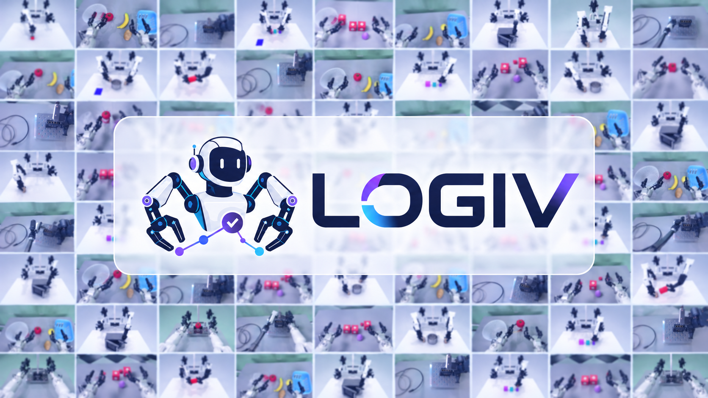

# LOGIV

### Graph-Verified Execution with Causal Local Repair for Long-Horizon Robot Tasks



[论文 PDF](ICRA_LOGIV.pdf) · [任务视频](#demos) · [文件介绍](#files) · [Benchmark 下载](#benchmarks) · [模型下载](#backbones) · [安装与接入](#integration)

## Abstract

Agentic robots must turn a high-level goal into actions while keeping the physical conditions needed for future steps valid. A completed action does not ensure that its effects will persist: a later disturbance can invalidate support that the remaining plan still assumes. We present LOGIV, a graph engineering framework for agentic robot execution that uses an explicit task graph to connect symbolic planning, observation-based verification, and embodied action. LOGIV compiles a validated plan into condition-support and resource-ordering edges, checks their physical validity during execution, and uses dependency tracing to determine what must be restored after a failure. Repair is constrained by retained unfinished actions, and the combined continuation is symbolically validated before execution resumes. The framework operates above existing Vision-Language-Action (VLA) and World Action Model (WAM) policies without adding trainable components. Across 20 dual-arm tasks from RoboTwin V2 and BiCoord with three execution backbones, LOGIV improves mean task success without injected disturbances by 10.67 and 15.33 percentage points, respectively. Under predefined perturbations, it achieves higher task completion and condition restoration than three adapted recovery baselines for every backbone on both benchmarks. On three real-robot tasks, successful trials increase from 12/30 to 17/30. These results support explicit, continuously checked task dependencies as a practical interface for reliable agentic robot execution.

<a id="demos"></a>

## Demo 视频

三个真实机器人任务的演示如下。点击动图或下方链接打开对应的完整 MP4；动图由原视频生成，降低分辨率与帧率以便预览。

| Pick Tomato · 抓取番茄 | Build Blocks · 搭建积木 | Insert Cable · 插接线缆 |
| :---: | :---: | :---: |
| [](LOGIV_Demos/01_pick_tomato.mp4) | [](LOGIV_Demos/02_build_blocks.mp4) | [](LOGIV_Demos/03_insert_cable.mp4) |
| [观看视频 · 13.15 秒](LOGIV_Demos/01_pick_tomato.mp4) | [观看视频 · 17.40 秒](LOGIV_Demos/02_build_blocks.mp4) | [观看视频 · 24.55 秒](LOGIV_Demos/03_insert_cable.mp4) |

**[观看完整演示 · 55.10 秒 · 1280 × 720](LOGIV_Demos/ICRA_submitted_1994_VI_i.mp4)**

## 简介

长时序机器人任务中的困难不止是完成当前动作：已经放好的支撑物可能被移动，后续动作依赖的物理条件也会随之失效。LOGIV 将经过验证的符号计划编译为任务图，持续检查动作之间的条件支撑与资源顺序，并沿依赖关系定位需要恢复的部分。

修复时，LOGIV 保留仍可使用的未完成动作，为失效条件生成局部修复片段，再验证修复片段与保留动作组成的完整后续计划。它运行在现有 VLA 和 WAM 执行策略之上，不引入额外可训练组件。论文在 RoboTwin V2 与 BiCoord 的 20 个双臂任务、三种执行策略及三个真实机器人任务上研究了这一机制。

## 方法概览

1. **构建任务图。** 使用 Fast Downward 生成符号计划，经 VAL 验证后，建立条件支撑边与资源顺序边。
2. **持续验证。** 在动作执行前、执行后以及检查已完成动作对剩余计划的支撑时，结合视觉观察与执行器反馈确认物理条件。
3. **定位局部失效。** 沿因果依赖区分受影响动作与必须替换的动作，保留可继续使用的未完成动作。
4. **修复并继续。** 从保留动作回归修复目标，生成修复片段；拼接后的计划通过符号验证后重建任务图，继续执行。

以下为[论文](ICRA_LOGIV.pdf)报告的结果。

| 实验 | 论文报告的改善 |
| --- | --- |
| RoboTwin V2，无注入扰动 | 平均任务成功率提高 **10.67 个百分点** |
| BiCoord，无注入扰动 | 平均任务成功率提高 **15.33 个百分点** |
| 三个真实机器人任务 | 成功试验数由 **12/30** 提升至 **17/30** |

<a id="files"></a>

## 项目结构

```text
LOGIV/
├── README.md
├── .gitignore
├── pyproject.toml
├── ICRA_LOGIV.pdf
├── LOGIV_logo_任务拼图.png
├── LOGIV_Demos/
│   ├── 01_pick_tomato.mp4
│   ├── 02_build_blocks.mp4
│   ├── 03_insert_cable.mp4
│   └── ICRA_submitted_1994_VI_i.mp4
├── assets/
│   └── demos/
└── logiv/
    ├── core/
    │   ├── symbolic.py
    │   ├── graph.py
    │   ├── execution.py
    │   ├── verification.py
    │   └── repair.py
    ├── planning/
    │   ├── pddl.py
    │   └── solver.py
    ├── perception/
    │   └── vision.py
    ├── benchmarks/
    │   ├── runtime.py
    │   ├── tasks.py
    │   ├── robotwin.py
    │   └── bicoord.py
    ├── pddl/
    │   ├── robotwin/move_can_pot/
    │   └── bicoord/build_bridge/
    ├── prompts/
    │   ├── state_assessment.txt
    │   ├── robotwin/move_can_pot.json
    │   └── bicoord/build_bridge.json
    └── configs/
        ├── robotwin/move_can_pot.json
        └── bicoord/build_bridge.json
```

| 文件或目录 | 用途 |
| --- | --- |
| [`ICRA_LOGIV.pdf`](ICRA_LOGIV.pdf) | 论文全文、算法、实验结果与附录 |
| [`LOGIV_logo_任务拼图.png`](LOGIV_logo_任务拼图.png) | README 顶部任务拼图 |
| [`LOGIV_Demos/`](LOGIV_Demos/) | 三个任务 MP4、完整演示、原始合辑，以及记录来源和校验值的 `sources.json` |
| [`assets/demos/`](assets/demos/) | README 中的 GIF 预览 |
| [`logiv/core/`](logiv/core/) | 符号状态、任务依赖图、执行循环、运行时验证与因果局部修复 |
| [`logiv/planning/`](logiv/planning/) | PDDL 解析、Fast Downward 规划器与 VAL 验证器接口 |
| [`logiv/perception/`](logiv/perception/) | 基于 GPT-4o 的视觉状态核查 |
| [`logiv/benchmarks/`](logiv/benchmarks/) | RoboTwin / BiCoord 环境接口、策略协议、任务列表与资源加载器 |
| [`logiv/pddl/`](logiv/pddl/) | `move_can_pot` 与 `build_bridge` 的符号任务定义 |
| [`logiv/prompts/`](logiv/prompts/) | 状态核查提示词、动作语言模板和对象／谓词描述 |
| [`logiv/configs/`](logiv/configs/) | 任务资源占用与静态谓词配置 |
| [`pyproject.toml`](pyproject.toml) | Python 版本、可选依赖与打包配置 |

每个 `pddl` 任务目录包含 `domain.pddl` 和 `problem.pddl`；`prompts` 保存状态核查指令、动作语言模板与对象／谓词定义；`configs` 保存资源占用和静态谓词。资源通过 `importlib.resources` 加载，并随安装包分发。目录树展示主要文件，原始视频与来源记录保留在 `LOGIV_Demos` 中。

<a id="benchmarks"></a>

## Benchmark 下载

项目接入 RoboTwin V2 与 BiCoord。以下链接指向各 benchmark 的官方项目、数据及仿真资产；数据与模型均单独下载，不随本仓库分发。

| Benchmark | 项目与代码 | 数据下载 | 仿真资产 |
| --- | --- | --- | --- |
| **RoboTwin V2** | [项目主页](https://robotwin-platform.github.io/) · [GitHub](https://github.com/RoboTwin-Platform/RoboTwin) | [演示数据](https://huggingface.co/datasets/TianxingChen/RoboTwin2.0/tree/main/dataset) · [LeRobot 格式](https://huggingface.co/datasets/TianxingChen/RoboTwin2.0/tree/main/lerobot_dataset) | [物体](https://huggingface.co/datasets/TianxingChen/RoboTwin2.0/blob/main/objects.zip) · [机器人](https://huggingface.co/datasets/TianxingChen/RoboTwin2.0/blob/main/embodiments.zip) · [背景纹理](https://huggingface.co/datasets/TianxingChen/RoboTwin2.0/blob/main/background_texture.zip) |
| **BiCoord** | [项目主页](https://buaa-colalab.github.io/BiCoord/) · [GitHub](https://github.com/buaa-colalab/BiCoord-Bench) | [任务演示数据](https://huggingface.co/datasets/GradiusTwinbee/BiCoord/tree/main) | [BiCoord 补充物体](https://huggingface.co/datasets/GradiusTwinbee/BiCoord/blob/main/objects.zip)，配合 RoboTwin 基础资产 |

RoboTwin 的环境安装参见[官方安装文档](https://robotwin-platform.github.io/doc/usage/robotwin-install.html)。BiCoord 基于 RoboTwin 2.0，并提供额外物体资产，安装顺序与数据组织见 [BiCoord 官方说明](https://github.com/buaa-colalab/BiCoord-Bench)。

<details>
<summary>下载命令：benchmark 代码、仿真资产与单任务数据</summary>

以下命令在 LOGIV 仓库根目录运行，使用已激活的 Python 环境。先安装 [Hugging Face CLI](https://huggingface.co/docs/huggingface_hub/guides/cli)，再按需要下载；`external/`、`downloads/` 和 `checkpoints/` 已加入 `.gitignore`。

```bash
python3 -m pip install -U huggingface_hub
mkdir -p external
git clone https://github.com/RoboTwin-Platform/RoboTwin.git external/RoboTwin
git clone https://github.com/buaa-colalab/BiCoord-Bench.git external/BiCoord-Bench
```

按上方官方说明完成对应仿真环境安装后，在 RoboTwin 的环境与目录中运行官方资产下载脚本：

```bash
cd external/RoboTwin
bash scripts/_download_assets.sh
cd ../..
```

BiCoord 同样需要 RoboTwin 基础资产，并需将补充物体解压到 `external/BiCoord-Bench/assets/objects`；按 [BiCoord 安装说明](https://github.com/buaa-colalab/BiCoord-Bench#installation)组织资产。下载补充物体和两个示例任务的数据：

```bash
# BiCoord 补充物体
hf download GradiusTwinbee/BiCoord objects.zip \
  --repo-type dataset --local-dir downloads/bicoord-assets

# RoboTwin：仅下载 move_can_pot 的 demo_clean 压缩包
hf download TianxingChen/RoboTwin2.0 dataset/move_can_pot/demo_clean.zip \
  --repo-type dataset --local-dir downloads/robotwin

# BiCoord：仅下载 build_bridge 的数据，保留任务目录结构
hf download GradiusTwinbee/BiCoord \
  --repo-type dataset --include 'build_bridge/**' \
  --local-dir external/BiCoord-Bench/data
```

RoboTwin 数据需按官方说明解压到对应任务的数据目录，再转换为所选策略需要的格式。下载其他任务时替换任务路径；需要 LeRobot 数据时使用上表中的对应入口。可在 `hf download` 命令后追加 `--dry-run` 查看文件和预计下载量，遇到需要登录或限流时运行 `hf auth login`。

</details>

<details>
<summary>论文中的 20 个任务</summary>

任务标识对应论文 Table A1，并采用环境中的下划线命名。接入层只接受以下任务。

| RoboTwin V2 | BiCoord |
| --- | --- |
| `beat_block_hammer` | `cook` |
| `blocks_ranking_size` | `put_objects_cabinet` |
| `handover_block` | `divide_block_tower` |
| `move_can_pot` | `place_plate_and_cup` |
| `open_microwave` | `build_bridge` |
| `place_dual_shoes` | `clean_table` |
| `stack_blocks_three` | `collect_pens` |
| `stack_bowls_three` | `match_blocks_with_signs` |
| `stamp_seal` | `jigsaw` |
| `turn_switch` | `exchange_mics` |

</details>

<a id="backbones"></a>

## 底层策略模型下载

论文使用 π0.5、AHA-WAM 与 Light-WAM 三种执行策略。下面列出上游公开的基础模型与任务权重下载入口，便于准备策略环境；它们不代表本项目已提供 LOGIV 实验使用的全部任务微调权重。

| 策略 | 官方代码 | 权重下载 | 权重类型 |
| --- | --- | --- | --- |
| **π0.5** | [Physical Intelligence / OpenPI](https://github.com/Physical-Intelligence/openpi) | [官方 `pi05_base` 目录](https://console.cloud.google.com/storage/browser/openpi-assets/checkpoints/pi05_base) · [checkpoint 说明](https://github.com/Physical-Intelligence/openpi#model-checkpoints) | 基础 VLA 权重，官方路径为 `gs://openpi-assets/checkpoints/pi05_base` |
| **AHA-WAM** | [AHA-WAM](https://github.com/serene-sivy/AHA-WAM) | [RoboTwin 2.0 权重](https://huggingface.co/SereneC/AHA-WAM-RoboTwin2.0/tree/main) · [预训练权重](https://huggingface.co/SereneC/AHA-WAM-Pretrained/tree/main) | RoboTwin 任务权重与 RoboCOIN 预训练初始化分别提供 |
| **Light-WAM** | [Light-WAM](https://github.com/L1ziang/Light-WAM) | [RoboTwin 权重](https://huggingface.co/l1ziang/lightwam-checkpoints/tree/main/lightwam_robotwin) · [全部公开权重](https://huggingface.co/l1ziang/lightwam-checkpoints/tree/main) | `lightwam_robotwin` 包含任务配置、归一化统计与 checkpoint |

π0.5 另有 [LeRobot 格式基础权重](https://huggingface.co/lerobot/pi05_base/tree/main)，应配合 LeRobot 实现使用，不能直接混用 OpenPI 的 checkpoint 加载方式。

AHA-WAM 与 Light-WAM 还依赖相应的视频模型资产。AHA-WAM 的加载配置与资产说明见[官方仓库](https://github.com/serene-sivy/AHA-WAM)，其 Hugging Face 资产入口为 [SereneC/wan-series-checkpoint](https://huggingface.co/SereneC/wan-series-checkpoint)。Light-WAM 使用 [Wan2.1-T2V-1.3B](https://huggingface.co/Wan-AI/Wan2.1-T2V-1.3B)。加载任务权重时，需同时采用对应的配置与归一化统计，并匹配机器人观测和动作空间。

<details>
<summary>下载命令：π0.5、AHA-WAM 与 Light-WAM</summary>

**LOGIV 本身没有额外需要下载的训练权重。** 选择所需的底层策略，按其官方仓库安装独立环境，再下载对应资产。

π0.5：在已安装 OpenPI 的环境中使用其下载工具，返回值为本地缓存路径：

```python
from openpi.shared import download

checkpoint_dir = download.maybe_download("gs://openpi-assets/checkpoints/pi05_base")
print(checkpoint_dir)
```

AHA-WAM 与 Light-WAM：安装上节的 Hugging Face CLI 后，在 LOGIV 仓库根目录运行所需命令：

```bash
# AHA-WAM：RoboTwin 权重、归一化统计与配置
hf download SereneC/AHA-WAM-RoboTwin2.0 \
  robotwin_ahawam.pt dataset_stats.json config.json \
  --local-dir checkpoints/aha-wam-robotwin

# Light-WAM：RoboTwin checkpoint 及对应配置和归一化统计
hf download l1ziang/lightwam-checkpoints \
  --include 'lightwam_robotwin/**' \
  --local-dir checkpoints/light-wam

# Light-WAM 依赖的视频模型；按其官方配置设置加载路径
hf download Wan-AI/Wan2.1-T2V-1.3B \
  --local-dir checkpoints/Wan-AI/Wan2.1-T2V-1.3B
```

AHA-WAM 的 Wan 组件与 ActionDiT 资产遵循其[官方加载配置](https://github.com/serene-sivy/AHA-WAM)，不能只下载单个任务 `.pt` 文件后直接运行。上述命令仅准备上游公开权重；LOGIV 实验所用的完整任务微调权重尚未随本仓库提供。

</details>

<a id="integration"></a>

## 安装与接入

主干使用 Python 3.11 或更高版本，符号模块只依赖标准库。视觉接入另需 OpenAI SDK 与 Pillow。克隆后，在独立环境中安装：

```bash
git clone https://github.com/Enqiao-Lu/LOGIV.git
cd LOGIV
python3 -m venv .venv
source .venv/bin/activate
python3 -m pip install -e '.[vision]'
```

无需模型或仿真器即可检查两套任务资源是否可加载：

```bash
python3 - <<'PY'
from logiv.benchmarks import load_task_bundle

for benchmark, task_name in (("robotwin", "move_can_pot"), ("bicoord", "build_bridge")):
    bundle = load_task_bundle(benchmark, task_name)
    print(f"{benchmark}/{task_name}: loaded {len(bundle.task.dynamic_atoms)} dynamic atoms")
PY
```

准备已编译的 [Fast Downward](https://github.com/aibasel/downward) 与 [VAL](https://github.com/KCL-Planning/VAL)，分别提供 `fast-downward.py` 与 `Validate` 的路径。两个模拟器与底层策略按各自官方说明准备，环境初始化、模型加载及动作预算由调用方提供。

下面展示一个任务资源包如何接入 LOGIV 主干。`environment`、`policy`、`client`、工具路径及预算是调用方已准备的对象与参数。

```python
from logiv import LOGIV
from logiv.benchmarks import BenchmarkRuntime, load_task_bundle
from logiv.core.verification import Verifier
from logiv.perception import GPT4o
from logiv.planning import FastDownward, VAL

bundle = load_task_bundle("bicoord", "build_bridge")
task = bundle.task
runtime = BenchmarkRuntime("bicoord", "build_bridge", environment, policy, action_budget)
perception = GPT4o(client, bundle.predicate_descriptions, bundle.object_descriptions)
verifier = Verifier(
    runtime,
    perception,
    tracked_atoms=task.dynamic_atoms,
    static_predicates=bundle.static_predicates,
)
controller = LOGIV(
    FastDownward(task, downward_path),
    VAL(task, validate_path),
    verifier,
    execution_budget,
)
result = controller.run(task.initial_state, task.goal)
```

`BenchmarkRuntime` 通过官方环境的 `get_obs()`、`set_instruction()` 与 `take_action()` 读取观察、设置子任务并执行控制。策略实现 `reset()` 和 `predict(raw_observation, instruction)`，后者返回 `ActionChunk(actions, done)`。`done` 只表示当前策略 rollout 停止；动作是否成功仍由视觉与执行器反馈验证。

`Result` 包含最终状态、执行轮数、已完成动作、失败记录与退出原因。只有最终目标得到观察确认时才返回 `SUCCESS`。

<details>
<summary>PDDL、提示词与接口约定</summary>

当前包含两个可求解的任务资源包，分别对应锅位移与桥梁支撑失效场景：

| 资源包 | 符号任务与修复能力 |
| --- | --- |
| `robotwin/move_can_pot` | 抓取并抬升罐子，再放到锅旁；锅偏离参考位置时，可由另一只手恢复锅的位置，保留持罐状态与后续放置动作 |
| `bicoord/build_bridge` | 放置两个支撑、双臂抓梁并架桥；双臂持梁时，可先放下梁，再修复支撑并重新抓梁 |

两套 PDDL 与提示词按论文接口及[官方 RoboTwin 任务](https://github.com/RoboTwin-Platform/RoboTwin/blob/main/envs/move_can_pot.py)、[官方 BiCoord 任务](https://github.com/buaa-colalab/BiCoord-Bench/blob/master/envs/build_bridge.py)重建，不是原始实验配置。其余 18 个任务目前仅有任务标识，调用其资源加载器会报告资源缺失。初始 Problem 不包含物理坐标、相机标定或随机种子；实际接入时应提供对应对象标识与目标位置。预置 `move_can_pot` 假设左臂持罐、另一只手移动锅。

`load_task_bundle(benchmark, task_name)` 同时读取 PDDL、配置与提示词，并检查对象、谓词及静态关系的一致性。自备任务可通过 `logiv.planning.load_task(domain_path, problem_path, instructions, resources)` 加载；动作语言模板与资源映射须覆盖全部动作模式。

PDDL 支持类型与子类型、常量、合取条件、正负文字、相等条件及无条件 add/delete 效果。数字流、时间动作、量词、析取、派生谓词和输入任务中的条件效果不受支持。

`GPT4o` 接收已配置的客户端、谓词描述与对象描述，默认读取 `logiv/prompts/state_assessment.txt`。视觉状态使用 `true`、`false`、`null` 区分成立、不成立与未知；格式错误或未知事实进入重观测流程。无法确认的事实不会被当成假，视觉与反馈冲突时保留未知。

`Verifier.tracked_atoms` 应覆盖修复规划需要的可变事实，可使用 `Task.dynamic_atoms`。`static_predicates` 仅用于确实不会被动作或外界扰动改变的关系；不能仅因某谓词未出现在算子效果中就认定它不可变。可选的 `feedback` 提供执行器事实，`active_perception` 用于重观测前调整视角。仿真器隐藏位姿与真值成功标签不能替代视觉核查。

</details>

<details>
<summary>执行参数与实现对应关系</summary>

主干对应论文 Section III 与 Appendix A 的 Algorithm 1/2。初始计划通过 VAL 后构图；每个动作执行前后核查条件，并检查 START 和已完成动作对未完成动作及 GOAL 的支撑。已完成节点的支撑失效不会重新打开该节点。

局部修复区分受影响集合与替换集合，从保留动作逆序回归目标。修复片段与保留动作拼接后由 VAL 验证；必要时扩大修复作用域。验证通过后从当前状态重建图，完成历史保留在 `Result.completed`。

| 参数 | 设置 |
| --- | --- |
| 初始规划器 | Fast Downward `lama-first` |
| 视觉模型 | `gpt-4o` |
| 单次视觉输出上限 | 512 tokens |
| 单次状态评估的额外观测 | 最多 3 次，总计最多 4 次调用 |
| 单次规划限时 | 30 秒 |
| 单次 VAL 限时 | 5 秒 |
| 每次失败的局部修复轮数 | 最多 3 轮 |
| 初始规划候选次数 | 默认 3 次，可配置 `preparation_attempts` |
| 总执行预算与子任务动作预算 | 调用方显式提供 |

初始规划候选次数与候选排除编码是本实现的工程选择。被 VAL 拒绝的完整候选序列通过临时 PDDL 前缀监视条件排除，VAL 始终检查原始任务语义。SDK 自动重试关闭；临时服务故障计入观察预算。若事实量超出输出容量或仍有未知事实，实现保守终止，不扩大视觉预算。

</details>

## 实现与验证范围

本仓库提供依据论文重建的 LOGIV 主干、两个 benchmark 的接入层，以及两套 PDDL／提示词示例。没有捆绑模型权重、训练代码、消融实验、批量评测或一键运行入口。完整实验复现仍需原始任务建模、全部任务提示词、策略微调权重、初始布局、扰动事件表与执行预算等配置。

上面的资源加载检查用于确认安装与示例文件完整性，不运行物理仿真、线上 GPT-4o 或策略推理。复现论文成功率与扰动恢复率需要另行准备完整实验配置；上方摘要、结果与 Demo 介绍论文工作。
