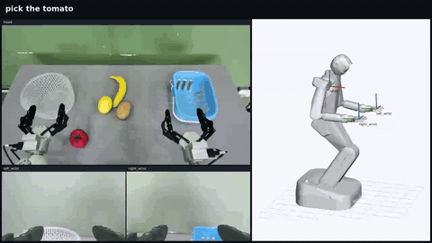
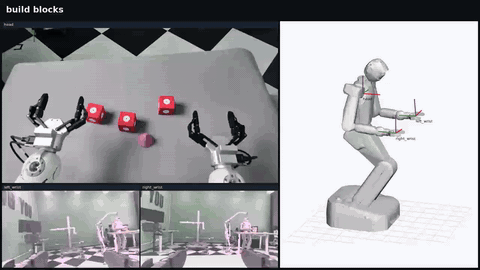
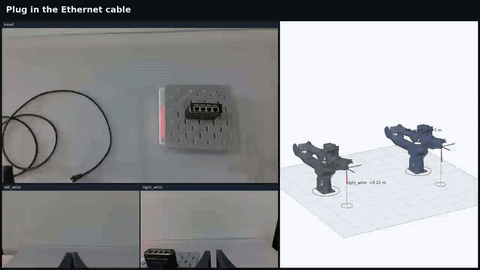

# LOGIV

### Graph-Verified Execution with Causal Local Repair for Long-Horizon Robot Tasks

[Task Videos](#demos) · [Repository Structure](#files) · [Benchmark Downloads](#benchmarks) · [Model Downloads](#backbones) · [Installation and Integration](#integration)

## Abstract

Agentic robots must turn a high-level goal into actions while keeping the physical conditions needed for future steps valid. A completed action does not ensure that its effects will persist: a later disturbance can invalidate support that the remaining plan still assumes. We present LOGIV, a graph engineering framework for agentic robot execution that uses an explicit task graph to connect symbolic planning, observation-based verification, and embodied action. LOGIV compiles a validated plan into condition-support and resource-ordering edges, checks their physical validity during execution, and uses dependency tracing to determine what must be restored after a failure. Repair is constrained by retained unfinished actions, and the combined continuation is symbolically validated before execution resumes. The framework operates above existing Vision-Language-Action (VLA) and World Action Model (WAM) policies without adding trainable components. Across 20 dual-arm tasks from RoboTwin V2 and BiCoord with three execution backbones, LOGIV improves mean task success without injected disturbances by 10.67 and 15.33 percentage points, respectively. Under predefined perturbations, it achieves higher task completion and condition restoration than three adapted recovery baselines for every backbone on both benchmarks. On three real-robot tasks, successful trials increase from 12/30 to 17/30. These results support explicit, continuously checked task dependencies as a practical interface for reliable agentic robot execution.

<a id="demos"></a>

## Task Videos

The following demonstrations cover three real-robot tasks. Click a preview or its link to open the corresponding MP4. GIF previews use reduced resolution and frame rate for convenient viewing.

| Pick Tomato | Build Blocks | Insert Cable |
| :---: | :---: | :---: |
| [](LOGIV_Demos/01_pick_tomato.mp4) | [](LOGIV_Demos/02_build_blocks.mp4) | [](LOGIV_Demos/03_insert_cable.mp4) |
| [Watch video · 13.15 s](LOGIV_Demos/01_pick_tomato.mp4) | [Watch video · 17.40 s](LOGIV_Demos/02_build_blocks.mp4) | [Watch video · 24.55 s](LOGIV_Demos/03_insert_cable.mp4) |

**[Watch the full demonstration · 55.10 s · 1280 × 720](LOGIV_Demos/ICRA_submitted_1994_VI_i.mp4)**

## Overview

Long-horizon robot tasks require more than completing the current action. A previously placed support may be displaced, invalidating the physical conditions required by later actions. LOGIV compiles a validated symbolic plan into a task graph, continuously checks condition support and resource ordering, and traces dependencies to identify what needs to be restored.

During repair, LOGIV retains usable unfinished actions, generates a local repair fragment for invalidated conditions, and validates the complete continuation formed by the repair fragment and retained actions. It operates above existing VLA and WAM execution policies without introducing trainable components. The paper evaluates this mechanism on 20 dual-arm tasks from RoboTwin V2 and BiCoord, three execution backbones, and three real-robot tasks.

## Method

1. **Build the task graph.** Generate a symbolic plan with Fast Downward, validate it with VAL, and construct condition-support and resource-ordering edges.
2. **Verify continuously.** Combine visual observations and executor feedback to check conditions before and after each action, including the support that completed actions provide to the remaining plan.
3. **Localize failures.** Trace causal dependencies to distinguish affected actions from actions that must be replaced, while retaining usable unfinished actions.
4. **Repair and resume.** Regress repair goals through retained actions, generate a repair fragment, validate the combined continuation, and rebuild the task graph before resuming execution.

The following results are reported in the paper.

| Evaluation | Reported improvement |
| --- | --- |
| RoboTwin V2, without injected disturbances | **+10.67 percentage points** in mean task success |
| BiCoord, without injected disturbances | **+15.33 percentage points** in mean task success |
| Three real-robot tasks | Successful trials increased from **12/30** to **17/30** |

<a id="files"></a>

## Repository Structure

```text
LOGIV/
├── README.md
├── .gitignore
├── pyproject.toml
├── LOGIV_Demos/
│   ├── 01_pick_tomato.mp4
│   ├── 02_build_blocks.mp4
│   ├── 03_insert_cable.mp4
│   └── ICRA_submitted_1994_VI_i.mp4
├── assets/
│   └── demos/
└── logiv/
    ├── core/
    │   ├── symbolic.py
    │   ├── graph.py
    │   ├── execution.py
    │   ├── verification.py
    │   └── repair.py
    ├── planning/
    │   ├── pddl.py
    │   └── solver.py
    ├── perception/
    │   └── vision.py
    ├── benchmarks/
    │   ├── runtime.py
    │   ├── tasks.py
    │   ├── robotwin.py
    │   └── bicoord.py
    ├── pddl/
    │   ├── robotwin/move_can_pot/
    │   └── bicoord/build_bridge/
    ├── prompts/
    │   ├── state_assessment.txt
    │   ├── robotwin/move_can_pot.json
    │   └── bicoord/build_bridge.json
    └── configs/
        ├── robotwin/move_can_pot.json
        └── bicoord/build_bridge.json
```

| File or directory | Purpose |
| --- | --- |
| [`LOGIV_Demos/`](LOGIV_Demos/) | Three task videos, the full demonstration, original compilations, and provenance and checksums in `sources.json` |
| [`assets/demos/`](assets/demos/) | GIF previews used in this README |
| [`logiv/core/`](logiv/core/) | Symbolic states, task dependency graphs, execution loop, runtime verification, and causal local repair |
| [`logiv/planning/`](logiv/planning/) | PDDL parsing and interfaces to Fast Downward and VAL |
| [`logiv/perception/`](logiv/perception/) | Visual state assessment with GPT-4o |
| [`logiv/benchmarks/`](logiv/benchmarks/) | RoboTwin / BiCoord environment interfaces, policy protocol, task lists, and resource loading |
| [`logiv/pddl/`](logiv/pddl/) | Symbolic task definitions for `move_can_pot` and `build_bridge` |
| [`logiv/prompts/`](logiv/prompts/) | State-assessment prompts, action instruction templates, and object/predicate descriptions |
| [`logiv/configs/`](logiv/configs/) | Task resource requirements and static predicate configuration |
| [`pyproject.toml`](pyproject.toml) | Python version, optional dependencies, and packaging configuration |

Each task directory under `pddl` contains `domain.pddl` and `problem.pddl`. The `prompts` directory defines state-assessment instructions, action templates, and object/predicate descriptions; `configs` defines resource requirements and static predicates. Resources are loaded through `importlib.resources` and included in the Python package. The tree shows the main files; original videos and provenance records are also retained in `LOGIV_Demos`.

<a id="benchmarks"></a>

## Benchmark Downloads

LOGIV provides interfaces for RoboTwin V2 and BiCoord. The links below point to their official projects, datasets, and simulation assets. Data and model weights are downloaded separately.

| Benchmark | Project and code | Datasets | Simulation assets |
| --- | --- | --- | --- |
| **RoboTwin V2** | [Project page](https://robotwin-platform.github.io/) · [GitHub](https://github.com/RoboTwin-Platform/RoboTwin) | [Demonstrations](https://huggingface.co/datasets/TianxingChen/RoboTwin2.0/tree/main/dataset) · [LeRobot format](https://huggingface.co/datasets/TianxingChen/RoboTwin2.0/tree/main/lerobot_dataset) | [Objects](https://huggingface.co/datasets/TianxingChen/RoboTwin2.0/blob/main/objects.zip) · [Robots](https://huggingface.co/datasets/TianxingChen/RoboTwin2.0/blob/main/embodiments.zip) · [Background textures](https://huggingface.co/datasets/TianxingChen/RoboTwin2.0/blob/main/background_texture.zip) |
| **BiCoord** | [Project page](https://buaa-colalab.github.io/BiCoord/) · [GitHub](https://github.com/buaa-colalab/BiCoord-Bench) | [Task demonstrations](https://huggingface.co/datasets/GradiusTwinbee/BiCoord/tree/main) | [Additional objects](https://huggingface.co/datasets/GradiusTwinbee/BiCoord/blob/main/objects.zip), used with the RoboTwin base assets |

Follow the [official RoboTwin installation guide](https://robotwin-platform.github.io/doc/usage/robotwin-install.html) to set up the simulation environment. BiCoord builds on RoboTwin 2.0 and adds modified object assets; see the [BiCoord instructions](https://github.com/buaa-colalab/BiCoord-Bench) for installation order and data organization.

<details>
<summary>Download commands: benchmark code, simulation assets, and individual tasks</summary>

Run the following commands from the LOGIV repository root in an activated Python environment. Install the [Hugging Face CLI](https://huggingface.co/docs/huggingface_hub/guides/cli), then download the assets you need. The `external/`, `downloads/`, and `checkpoints/` directories are already excluded by `.gitignore`.

```bash
python3 -m pip install -U huggingface_hub
mkdir -p external
git clone https://github.com/RoboTwin-Platform/RoboTwin.git external/RoboTwin
git clone https://github.com/buaa-colalab/BiCoord-Bench.git external/BiCoord-Bench
```

After installing the simulation environment using the official instructions above, run the asset download script in the RoboTwin environment and directory:

```bash
cd external/RoboTwin
bash scripts/_download_assets.sh
cd ../..
```

BiCoord also requires the RoboTwin base assets. Extract its additional objects into `external/BiCoord-Bench/assets/objects`, following the [BiCoord installation instructions](https://github.com/buaa-colalab/BiCoord-Bench#installation). Download the additional objects and data for the two example tasks:

```bash
# Additional BiCoord objects
hf download GradiusTwinbee/BiCoord objects.zip \
  --repo-type dataset --local-dir downloads/bicoord-assets

# RoboTwin: download only the move_can_pot demo_clean archive
hf download TianxingChen/RoboTwin2.0 dataset/move_can_pot/demo_clean.zip \
  --repo-type dataset --local-dir downloads/robotwin

# BiCoord: download only build_bridge, preserving the task directory structure
hf download GradiusTwinbee/BiCoord \
  --repo-type dataset --include 'build_bridge/**' \
  --local-dir external/BiCoord-Bench/data
```

Extract RoboTwin data into the appropriate task data directory using the official instructions, then convert it to the format required by your policy. Replace the task path to download other tasks, or use the LeRobot link above for data in that format. Append `--dry-run` to an `hf download` command to inspect the files and expected download size. Run `hf auth login` if authentication is required or you encounter rate limits.

</details>

<details>
<summary>The 20 tasks evaluated in the paper</summary>

Task identifiers correspond to Table A1 in the paper, using the environments' underscore-separated names. The integration layer accepts the following identifiers.

| RoboTwin V2 | BiCoord |
| --- | --- |
| `beat_block_hammer` | `cook` |
| `blocks_ranking_size` | `put_objects_cabinet` |
| `handover_block` | `divide_block_tower` |
| `move_can_pot` | `place_plate_and_cup` |
| `open_microwave` | `build_bridge` |
| `place_dual_shoes` | `clean_table` |
| `stack_blocks_three` | `collect_pens` |
| `stack_bowls_three` | `match_blocks_with_signs` |
| `stamp_seal` | `jigsaw` |
| `turn_switch` | `exchange_mics` |

</details>

<a id="backbones"></a>

## Policy Model Downloads

The paper uses three execution backbones: π0.5, AHA-WAM, and Light-WAM. The links below provide upstream base models and task checkpoints for preparing policy environments. They do not constitute the complete set of task-specific weights used in the LOGIV experiments.

| Policy | Official code | Weight downloads | Checkpoint type |
| --- | --- | --- | --- |
| **π0.5** | [Physical Intelligence / OpenPI](https://github.com/Physical-Intelligence/openpi) | [Official `pi05_base` directory](https://console.cloud.google.com/storage/browser/openpi-assets/checkpoints/pi05_base) · [Checkpoint documentation](https://github.com/Physical-Intelligence/openpi#model-checkpoints) | Base VLA weights at `gs://openpi-assets/checkpoints/pi05_base` |
| **AHA-WAM** | [AHA-WAM](https://github.com/serene-sivy/AHA-WAM) | [RoboTwin 2.0 weights](https://huggingface.co/SereneC/AHA-WAM-RoboTwin2.0/tree/main) · [Pretrained weights](https://huggingface.co/SereneC/AHA-WAM-Pretrained/tree/main) | RoboTwin task weights and RoboCOIN pretrained initialization are provided separately |
| **Light-WAM** | [Light-WAM](https://github.com/L1ziang/Light-WAM) | [RoboTwin weights](https://huggingface.co/l1ziang/lightwam-checkpoints/tree/main/lightwam_robotwin) · [All public weights](https://huggingface.co/l1ziang/lightwam-checkpoints/tree/main) | `lightwam_robotwin` includes the task configuration, normalization statistics, and checkpoint |

π0.5 also has [base weights in LeRobot format](https://huggingface.co/lerobot/pi05_base/tree/main). Use these with the LeRobot implementation; they are not directly interchangeable with OpenPI checkpoints.

AHA-WAM and Light-WAM also require video model assets. See the [AHA-WAM repository](https://github.com/serene-sivy/AHA-WAM) for loading configuration and asset requirements, including the Hugging Face mirror [SereneC/wan-series-checkpoint](https://huggingface.co/SereneC/wan-series-checkpoint). Light-WAM uses [Wan2.1-T2V-1.3B](https://huggingface.co/Wan-AI/Wan2.1-T2V-1.3B). Load each task checkpoint with its matching configuration and normalization statistics, and ensure compatibility with the robot's observation and action spaces.

<details>
<summary>Download commands: π0.5, AHA-WAM, and Light-WAM</summary>

**LOGIV itself has no additional trainable weights to download.** Choose an execution policy, install its environment using the official repository, and download the required assets.

For π0.5, use the download utility in an environment with OpenPI installed. The return value is the local cache path:

```python
from openpi.shared import download

checkpoint_dir = download.maybe_download("gs://openpi-assets/checkpoints/pi05_base")
print(checkpoint_dir)
```

For AHA-WAM and Light-WAM, install the Hugging Face CLI as described above and run the commands you need from the LOGIV repository root:

```bash
# AHA-WAM: RoboTwin weights, normalization statistics, and configuration
hf download SereneC/AHA-WAM-RoboTwin2.0 \
  robotwin_ahawam.pt dataset_stats.json config.json \
  --local-dir checkpoints/aha-wam-robotwin

# Light-WAM: RoboTwin checkpoint, configuration, and normalization statistics
hf download l1ziang/lightwam-checkpoints \
  --include 'lightwam_robotwin/**' \
  --local-dir checkpoints/light-wam

# Light-WAM video backbone; set its loading path in the official configuration
hf download Wan-AI/Wan2.1-T2V-1.3B \
  --local-dir checkpoints/Wan-AI/Wan2.1-T2V-1.3B
```

AHA-WAM's Wan components and ActionDiT assets must follow its [official loading configuration](https://github.com/serene-sivy/AHA-WAM); a task `.pt` file alone is insufficient to run the policy. These commands prepare public upstream checkpoints. The full set of task-specific weights used in the LOGIV experiments is not included in this repository.

</details>

<a id="integration"></a>

## Installation and Integration

LOGIV requires Python 3.11 or later. Its symbolic core uses only the standard library; visual integration additionally requires the OpenAI SDK and Pillow. Clone the repository and install it in a dedicated environment:

```bash
git clone https://github.com/Enqiao-Lu/LOGIV.git
cd LOGIV
python3 -m venv .venv
source .venv/bin/activate
python3 -m pip install -e '.[vision]'
```

Check that both task bundles load without downloading models or installing a simulator:

```bash
python3 - <<'PY'
from logiv.benchmarks import load_task_bundle

for benchmark, task_name in (("robotwin", "move_can_pot"), ("bicoord", "build_bridge")):
    bundle = load_task_bundle(benchmark, task_name)
    print(f"{benchmark}/{task_name}: loaded {len(bundle.task.dynamic_atoms)} dynamic atoms")
PY
```

Build [Fast Downward](https://github.com/aibasel/downward) and [VAL](https://github.com/KCL-Planning/VAL), and provide the paths to `fast-downward.py` and `Validate`. Install the simulators and execution policies using their official instructions. Environment initialization, model loading, and action budgets are supplied by the caller.

The example below connects a task bundle to LOGIV. It assumes that `environment`, `policy`, `client`, tool paths, and budget values have already been prepared.

```python
from logiv import LOGIV
from logiv.benchmarks import BenchmarkRuntime, load_task_bundle
from logiv.core.verification import Verifier
from logiv.perception import GPT4o
from logiv.planning import FastDownward, VAL

bundle = load_task_bundle("bicoord", "build_bridge")
task = bundle.task
runtime = BenchmarkRuntime("bicoord", "build_bridge", environment, policy, action_budget)
perception = GPT4o(client, bundle.predicate_descriptions, bundle.object_descriptions)
verifier = Verifier(
    runtime,
    perception,
    tracked_atoms=task.dynamic_atoms,
    static_predicates=bundle.static_predicates,
)
controller = LOGIV(
    FastDownward(task, downward_path),
    VAL(task, validate_path),
    verifier,
    execution_budget,
)
result = controller.run(task.initial_state, task.goal)
```

`BenchmarkRuntime` uses the official environments' `get_obs()`, `set_instruction()`, and `take_action()` methods to observe the scene, set a subtask instruction, and execute controls. Policies implement `reset()` and `predict(raw_observation, instruction)`, with the latter returning `ActionChunk(actions, done)`. The `done` flag indicates that the current policy rollout has stopped; action success is still determined through visual verification and executor feedback.

`Result` contains the final state, execution step count, completed actions, failure records, and termination reason. `SUCCESS` is returned only when observations confirm the final goal.

<details>
<summary>PDDL, prompts, and interface conventions</summary>

Two solvable task bundles are included, covering pot displacement and bridge-support failures:

| Task bundle | Symbolic task and repair behavior |
| --- | --- |
| `robotwin/move_can_pot` | Pick up and lift a can, then place it beside a pot. If the pot moves away from its reference position, the other hand can restore it while retaining the can grasp and subsequent placement action. |
| `bicoord/build_bridge` | Place two supports, grasp a beam with both arms, and assemble a bridge. If a support fails while both arms hold the beam, the robot can set down the beam, repair the support, and grasp the beam again. |

These PDDL models and prompts were reconstructed from the paper's interfaces and the official [RoboTwin task](https://github.com/RoboTwin-Platform/RoboTwin/blob/main/envs/move_can_pot.py) and [BiCoord task](https://github.com/buaa-colalab/BiCoord-Bench/blob/master/envs/build_bridge.py). They are not the original experimental configurations. The other 18 tasks currently have identifiers only; attempting to load their bundles reports missing resources. Initial problem files do not include physical coordinates, camera calibration, or random seeds. Supply the corresponding object identities and target positions when integrating with an environment. The provided `move_can_pot` bundle assumes that the left arm holds the can while the other hand moves the pot.

`load_task_bundle(benchmark, task_name)` reads the PDDL, configuration, and prompts together, and checks consistency between objects, predicates, and static relations. Custom tasks can be loaded with `logiv.planning.load_task(domain_path, problem_path, instructions, resources)`. Instruction templates and resource mappings must cover every action schema.

The PDDL parser supports types and subtypes, constants, conjunctive conditions, positive and negative literals, equality conditions, and unconditional add/delete effects. Numeric fluents, temporal actions, quantifiers, disjunctions, derived predicates, and conditional effects in input tasks are not supported.

`GPT4o` accepts a configured client, predicate descriptions, and object descriptions. By default, it reads `logiv/prompts/state_assessment.txt`. Visual state assessment uses `true`, `false`, and `null` for true, false, and unknown facts. Malformed responses or unknown facts trigger reobservation. Unconfirmed facts are not treated as false; conflicts between vision and feedback remain unknown.

`Verifier.tracked_atoms` should cover the dynamic facts required for repair planning; `Task.dynamic_atoms` can be used for this purpose. Use `static_predicates` only for relations that cannot change through actions or external disturbances. A predicate's absence from operator effects alone does not establish that it is static. Optional `feedback` supplies executor facts, and `active_perception` can adjust the viewpoint before reobservation. Hidden simulator poses and ground-truth success labels must not replace visual verification.

</details>

<details>
<summary>Execution settings and implementation details</summary>

The core follows Section III and Algorithms 1/2 in Appendix A of the paper. The initial plan is validated by VAL before graph construction. Conditions are checked before and after each action, including support from START and completed actions to unfinished actions and GOAL. Invalidating support from a completed node does not reopen that node.

Local repair distinguishes the affected set from the replacement set, and regresses goals backward through retained actions. The repair fragment and retained actions are combined and validated by VAL; the repair scope is expanded when needed. After successful validation, the graph is rebuilt from the current state, while completion history is preserved in `Result.completed`.

| Parameter | Setting |
| --- | --- |
| Initial planner | Fast Downward `lama-first` |
| Vision model | `gpt-4o` |
| Maximum output per vision call | 512 tokens |
| Additional observations per state assessment | Up to 3, for at most 4 calls in total |
| Timeout per planning call | 30 seconds |
| Timeout per VAL call | 5 seconds |
| Local repair rounds per failure | Up to 3 |
| Initial planning attempts | 3 by default; configurable through `preparation_attempts` |
| Overall execution and subtask action budgets | Explicitly supplied by the caller |

The initial planning attempt limit and candidate exclusion encoding are engineering choices in this implementation. Complete candidate sequences rejected by VAL are excluded using temporary PDDL prefix-monitor conditions; VAL always checks the original task semantics. Automatic SDK retries are disabled, and transient service failures count toward the observation budget. If the facts exceed the output capacity or remain unknown, execution terminates conservatively without expanding the vision budget.

</details>

## Implementation and Validation Scope

This repository provides a LOGIV core reconstructed from the paper, integration layers for two benchmarks, and two example PDDL/prompt bundles. It does not include model weights, training code, ablation experiments, batch evaluation, or a one-command execution entry point. Full experimental reproduction still requires the original task models, prompts for all tasks, fine-tuned policy weights, initial layouts, perturbation schedules, and execution budgets.

The resource-loading check above verifies installation and example-file completeness. It does not run physical simulation, online GPT-4o calls, or policy inference. Reproducing the paper's success and disturbance-recovery rates requires the complete experimental configuration. The abstract, results, and demonstrations above describe the work reported in the paper.
